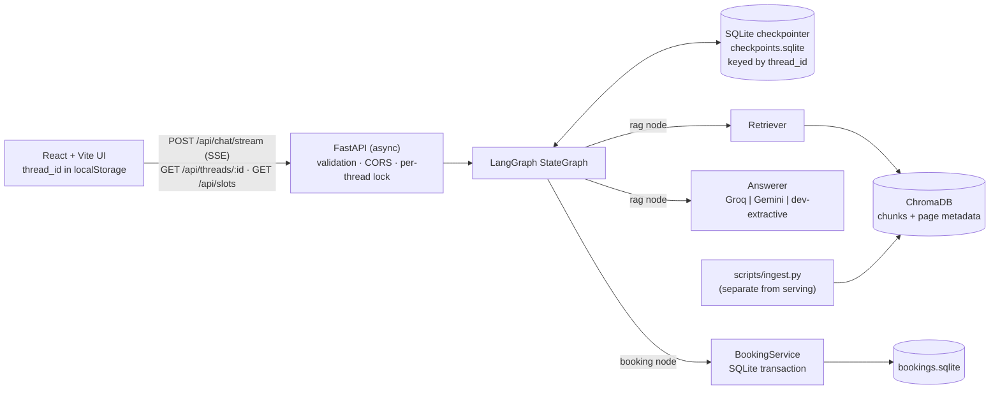

# NEXUS — Stateful AI Service Assistant

A full-stack agentic assistant that handles **two kinds of request in one conversation**:

1. **Knowledge retrieval (RAG)** over the public *Employee Handbook* PDF, with page citations.
2. **Transactional booking** of a *Performance Review* session (name → email → slot → confirmation → reference ID).

Its defining behaviour is **context interleaving**: ask a handbook question in the middle of a booking, get a grounded answer, and the booking resumes with everything already collected still intact — across separate HTTP requests, page refreshes and backend restarts.

**Stack:** Python 3.10+ · FastAPI (async) · LangGraph `StateGraph` + `AsyncSqliteSaver` · ChromaDB · pypdf · React 18 + Vite + TypeScript + Tailwind + lucide-react · SQLite · Groq / Gemini (optional) 

> **Read this first — honest status.** Everything marked ✅ below was executed and observed while building this repo (77 backend tests, a live server run against the real PDF, a production frontend build). Items under [Known limitations & unverified behaviour](#known-limitations--unverified-behaviour) were **not** verified — chiefly real Groq/Gemini calls, the `fastembed` model, and visual/browser behaviour of the UI. The AI Engineering Log contains only problems that actually occurred.

---

## 1. Requirement mapping

| Assessment requirement | Where | Status |
|---|---|---|
| LangGraph `StateGraph` with nodes & edges | `backend/app/graph/builder.py` | ✅ |
| Conditional router | `graph/routing.py`, `graph/nlu.py`, `graph/nodes/router.py` | ✅ |
| Typed state schema | `graph/state.py` (`TypedDict`) | ✅ |
| Checkpointer persistence by `thread_id` | `persistence/checkpointing.py` (SQLite, async) | ✅ survives graph rebuild & server restart |
| PDF ingestion → chunks → ChromaDB, page citations | `rag/ingestion.py`, `rag/retriever.py` | ✅ (real PDF, 11 pages → 27 chunks) |
| Multi-turn booking: name, email, slot | `graph/nodes/booking.py`, `services/booking_service.py` | ✅ |
| Context interleaving | tested in `tests/test_graph.py`, `tests/test_api.py` | ✅ |
| `POST /api/chat`, `GET /api/slots` | `api/routes/api.py` | ✅ |
| React chat UI: messages, thread ID, status | `frontend/src` | ✅ builds; ⚠ not browser-tested here |
| README + AI Engineering Log | this file | ✅ |
| *Bonus* SSE streaming + live node badge | `POST /api/chat/stream`, `StatusBadge` | ✅ node-level progress (**not** token streaming) |
| *Bonus* prompt-injection / leak guardrails | `nlu.LEAK`, `answerers.validate_citations`, tests | ✅ (heuristic, see limits) |
| *Bonus* Docker / docker-compose | — | ❌ not implemented |

## 2. Architecture



### LangGraph (exported from the compiled graph)


* **router** — deterministic turn analysis (`nlu.analyze_turn`): splits the message into sentences; sentences that are questions become the FAQ query, the rest is mined for name, email, slot choice, yes/no, cancel. It also detects prompt-injection/secret-exfiltration attempts. *Design decision:* routing and every transactional parse is rule-based so it is unit-testable and cannot be talked into anything; the LLM is used **only** to phrase grounded answers.
* **rag** — retrieves top-k passages, applies a similarity floor, asks the answerer, then **validates citations** (any `[Source: …, page N]` not in the retrieved set is stripped; if none remain, the top retrieved page is cited). No evidence ⇒ a fallback message with **no** citations.
* **booking** — collects/validates fields, offers slots from `BookingService`, asks for explicit confirmation, then calls `BookingService.book()`. `status="confirmed"` and the reference are set **only after the DB transaction returns**.
* **finalize** — joins the turn's reply parts into one `AIMessage` (with citations + node trace attached).

**Interleaving mechanics.** In a mixed message (`"Alex Chen (alex@…). Wait, how often…?"`) the router extracts name+email *and* the question. The graph goes `router → rag → booking → finalize`: the RAG answer is written first, then the booking node appends "Returning to your booking, Alex — available slots…". Because booking data lives in checkpointed state (`booking` key) and the RAG node never writes to it, an FAQ can't disturb it.

**State & reducers.** Only `messages` has a reducer (`add_messages`, de-duplicating by message id). All other keys are last-write-wins and each is rewritten by exactly one node per turn. The graph is acyclic within a turn, so routing cannot loop.

**Persistence.** `AsyncSqliteSaver` is opened once in the FastAPI lifespan and the graph is compiled against it. The client generates a UUID `thread_id` (stored in `localStorage`); every request passes `configurable.thread_id`. Verified: state is reloaded by a *new* graph object on a *new* connection to the same file, and across a real `uvicorn` restart.

**Booking lifecycle & guarantees** (`services/booking_service.py`)

`collecting → awaiting_slot → awaiting_confirmation → confirmed` (or `cancelled` at any active step). Persisted booking status: `confirmed → cancelled` (terminal; frees the slot).

* Slots come from the service (next 5 business days × 10:30, 11:00, 15:00, 16:30, `Asia/Kolkata`, ≥2 h lead); `GET /api/slots` returns them minus booked ones.
* `book()` runs in `BEGIN IMMEDIATE`; a **partial unique index** on `slot_id WHERE status='confirmed'` is the final backstop against double booking (tested with 8 concurrent threads → exactly 1 success).
* **Idempotent:** key = `sha256(thread|slot|email|type)`; a retry returns the original booking (`created=False`) instead of a duplicate.
* Name/email validated deterministically (`email-validator`); slot ids are checked against the generated set (forged/past ids rejected).
* Unexpected exception ⇒ transaction rolled back, draft state kept, user told "**not** created", `error="booking_failed"`, retry works (tested).
* `BOOKING_REQUIRE_CONFIRMATION=true` (default) asks for an explicit "yes". Set `false` to reproduce the PDF's sample dialogue exactly (slot choice books immediately).

**RAG pipeline** (`rag/`): download PDF → `pypdf` per-page extraction (empty pages skipped, per-page errors logged) → 800-char chunks, 150 overlap, sentence-boundary cuts → embeddings → Chroma `upsert` with deterministic ids (`employee_handbook.pdf:p04-c01`) and metadata `{source, page, chunk, embedder}`. Re-running is idempotent; `--rebuild` drops the index; an embedder mismatch refuses to mix vectors. Ingestion is a separate script, never part of a chat request.

## 3. API

| Method & path | Purpose |
|---|---|
| `GET /api/health` | status, `llm_mode`, embedder, `index_ready`, timezone |
| `GET /api/slots` | available slots from the booking service |
| `POST /api/chat` | one turn, JSON response |
| `POST /api/chat/stream` | same turn as SSE: `node` events (real graph progress) then `final` |
| `GET /api/threads/{thread_id}` | restore messages + booking state after refresh |
| `GET /api/bookings/{reference}` | booking lookup (email/name redacted: the demo has no auth) |

```http
POST /api/chat
{"thread_id":"750a862d-9a81-4684-a540-069d07f0008f",
 "message":"How often are performance reviews conducted?",
 "client_message_id":"m_123",   // optional; makes retries safe (processed at most once)
 "slot_id":"2026-10-16T10:30"}  // optional; set by UI slot buttons
```
```json
{"thread_id":"750a…","reply":"Performance reviews are conducted annually … [Source: employee_handbook.pdf, page 4]",
 "citations":[{"source":"employee_handbook.pdf","page":4,"snippet":"…","score":0.33,"chunk_id":"employee_handbook.pdf:p04-c01"}],
 "booking":{"status":"idle","offered_slots":[],"reference":null,"…":"…"},
 "intent":"faq","trace":["router","rag","finalize"],"error":null,"llm_mode":"dev","duplicate":false}
```
Errors: `422` invalid UUID/slot/ids, `413` message > `MAX_MESSAGE_CHARS` or body > 16 KB, `504` turn timeout, `500` generic body (no internals). LLM outage does **not** 500: the reply says so, `error:"llm_unavailable"`, and booking state is untouched.

## 4. Setup

**Prerequisites:** Python 3.10+ (tested on 3.12), Node 18+ (tested on 22), internet for the first ingestion.

```bash
# --- backend ---
cd backend
python -m venv .venv && source .venv/bin/activate      # Windows: .venv\Scripts\activate
pip install -r requirements.txt
cp ../.env.example .env                                 # then edit (see below)
python -m scripts.ingest --download --rebuild           # downloads the public PDF + builds the index
uvicorn app.main:create_app --factory --port 8000

# --- frontend (new terminal) ---
cd frontend
npm install
npm run dev                                             # http://localhost:5173 (proxies /api -> :8000)
```

**Choosing providers** (`backend/.env`)

| Variable | Default | Notes |
|---|---|---|
| `LLM_PROVIDER` | `dev` | `dev` = extractive, **no LLM**, labelled in UI and replies. `groq` or `gemini` need the matching key. |
| `GROQ_API_KEY` / `GROQ_MODEL` | – / `llama-3.3-70b-versatile` | verify the model id is still current |
| `GEMINI_API_KEY` / `GEMINI_MODEL` | – / `gemini-2.5-flash` | verify the model id is still current |
| `EMBEDDING_PROVIDER` | `fastembed` | `fastembed` = local `BAAI/bge-small-en-v1.5` (downloads once). `hash` = offline lexical fallback (not semantic). |
| `RAG_MIN_SCORE` | per embedder | `hash` 0.07 (calibrated), `fastembed` 0.40 (**uncalibrated**) |
| `BOOKING_REQUIRE_CONFIRMATION` | `true` | see above |
| `CORS_ORIGINS`, `MAX_MESSAGE_CHARS`, `TIMEZONE`, `CHUNK_SIZE`, `CHUNK_OVERLAP`, `RAG_TOP_K`, `LOG_LEVEL` | see `.env.example` | |

If the embedding model can't be downloaded: `EMBEDDING_PROVIDER=hash`, then re-run ingestion with `--rebuild`.

**Tests & evaluation**
```bash
cd backend
pytest -q                                   # 76 offline tests (temp DBs, no network, mocked providers)
RUN_NETWORK_TESTS=1 pytest -q               # + downloads the real PDF (77 tests)
python -m scripts.evaluate --json eval/results.json    # RAG evaluation on eval/dev_questions.json
python -m scripts.demo_dialogue             # replays the PDF's sample dialogue against a running server
```
**Real-provider integration check (manual — not run here):** set `LLM_PROVIDER=groq` (or `gemini`) + key, start the server, run `python -m scripts.evaluate --answerer configured` and `python -m scripts.demo_dialogue`; `GET /api/health` should show `"llm_mode":"groq"`, and answers should lack the "Dev mode" footer.

## 5. Verification artifacts (actually executed)

**Test results:** `77 passed` (with `RUN_NETWORK_TESTS=1`), `76 passed, 1 skipped` offline. Coverage by type — *unit:* booking service, chunking, retrieval, citation validation, NLU/routing, provider request/response shapes (mocked `httpx`); *integration (in-process):* graph + SQLite checkpointer, FastAPI `TestClient` (flows, restart, isolation, CORS, SSE, security); *live:* real PDF download+ingest, real `uvicorn` run below. **Frontend:** `npm run build` (strict `tsc` + Vite) succeeded; **no automated UI tests exist**.

**Live transcript** (real handbook, `uvicorn`, dev mode, hash embedder — `python -m scripts.demo_dialogue`):
```
USER : Hi, I need to book a 1-on-1 Performance Review session.
AGENT: I'd be happy to help schedule a Performance Review session. May I have your full name and your email address?
       [intent=booking trace=router>booking>finalize booking=collecting]
USER : Alex Chen (alex.chen@example.com). Wait, before that, how often are performance reviews conducted according to the handbook?
AGENT: Performance reviews are conducted annually and are an important part of your career development. [Source: employee_handbook.pdf, page 4]
       _Dev mode: extractive answer from the handbook, no LLM used._
       Returning to your booking, Alex - available slots:
       1) Today, Thu 15 Oct · 3:00 PM IST  2) Today … 4:30 PM IST  3) Tomorrow … 10:30 AM IST  4) … 11:00 AM IST  5) … 3:00 PM IST
       [intent=faq_during_booking trace=router>rag>booking>finalize booking=awaiting_slot cites=[4]]
USER : Let's go with option 2
AGENT: Please confirm: Performance Review on Today, Thu 15 Oct · 4:30 PM IST for Alex Chen (alex.chen@example.com). Reply yes to confirm …
       [booking=awaiting_confirmation]
USER : yes
AGENT: Confirmed! … Reference ID: #REV-TJJ3XB.     [booking=confirmed ref=REV-TJJ3XB]
```
After killing and restarting `uvicorn`: `GET /api/threads/<id>` → 8 messages, booking `confirmed REV-TJJ3XB`; `GET /api/bookings/REV-TJJ3XB` → `confirmed`. SSE emitted `router → rag → finalize` then `final`. A CORS preflight from `http://evil.example` received no `Access-Control-Allow-Origin`.

> **Note the answer differs from the PDF's sample dialogue.** The sample says reviews happen "twice a year (mid-year and annual)". The real handbook says **annually**. The agent reports what the indexed document says. The real handbook (company "Zava") also contains **no PTO or benefits content** — those live in the secondary *Northwind benefits* PDF, which is **not** ingested; PTO questions correctly get the "couldn't find that" fallback.

**RAG evaluation** (`eval/results_hash_embedder.json`; 15 answerable + 7 out-of-scope hand-written questions; **hash embedder + dev extractive answerer**, top-k 4, floor 0.07 — it says nothing about the `fastembed` or LLM configurations):

| Metric | Result |
|---|---|
| Retrieval hit@1 / hit@4 / MRR | 0.87 / 1.00 / 0.92 |
| Answered (not declined) | 11 / 15 |
| Cited page correct, among answered | 11 / 11 (1.00) |
| Expected key phrase present, among answered | 9 / 11 (0.82) |
| Out-of-scope correctly declined | 7 / 7 (4 by the answerer's coverage gate, 3 by the retrieval floor) |

*Error analysis.* (a) 4 answerable questions were wrongly **declined** (industry, password requirements, anonymous reporting, job roles): their best chunk scored below the floor or no sentence covered half the question's terms — the lexical embedder can't bridge vocabulary ("anonymously" vs "anonymous reporting"). (b) 2 answered questions lacked the expected phrase: the extractive answerer quoted a nearby sentence. (c) In-scope and out-of-scope similarity scores **overlap** for this embedder (min in-scope top-1 0.078 vs max out-of-scope 0.113), so a threshold alone can't separate them — hence the second gate. Chunk sizes 300–800 were swept; none improved separability, so the spec's 800/150 was kept. The dataset is small and hand-written by the developer: treat it as a regression/calibration aid, not a benchmark.

**Manual UI checklist (not yet done by me — please capture screenshots):** empty state; FAQ with citation chip → source drawer; booking form validation (bad name/email); slot buttons; confirm → reference card; FAQ mid-booking keeps the panel at step 2; refresh restores thread; "New conversation" gives a new thread ID; stop the backend → "Unreachable" status + retry banner; mobile width (menu + booking drawer); keyboard: Enter / Shift+Enter, Esc closes drawers.

## 6. Security

Implemented & tested: UUID-validated `thread_id` (no path/SQL surface; thread isolation tested); strict slot-id/client-id formats; message (2000 chars) and body (16 KB) limits; parameterised SQL only; CORS limited to configured origins, `GET/POST`, no credentials; generic 500 bodies; logs contain no message text, emails or keys (thread ids are hashed); API keys are `SecretStr`, never returned, provider errors never include them (tested); retrieved PDF text is wrapped in `<context>` and the prompt declares it untrusted data; model-invented citations are stripped; LLM output can never mark a booking successful; `react-markdown` without raw HTML (untrusted text can't inject markup); the source drawer renders snippets as plain text; `/api/bookings/{ref}` redacts PII.

## 7. Known limitations & unverified behaviour

* ❌ **Real Groq/Gemini calls were never made** (no network access to them here). Request/response shapes are unit-tested against mocked `httpx` transports only; model ids may need updating.
* ❌ **`fastembed` was not run** (Hugging Face is unreachable from the build sandbox). Its default threshold 0.40 is a guess — run the evaluation and set `RAG_MIN_SCORE`.
* ❌ **The UI was never opened in a browser** (typecheck + production build only); no frontend tests; no Windows/macOS run.
* No token-level streaming (SSE reports node completion). No Docker. No auth or rate limiting (a per-process `asyncio` lock serialises turns per thread, so this targets a single worker; multi-worker needs a distributed lock). Injection defence is heuristic (regex + prompt hygiene), not a guarantee.
* Rule-based NLU is English-only and brittle to unusual phrasing; names with digits/no surname are rejected by design.
* Dev mode answers are extractive quotes, sometimes imprecise (see error analysis).
* The secondary benefits PDF is not ingested.

## 8. AI Engineering Log

**AI tools used:** Claude (Anthropic, via the claude.ai chat interface with a code sandbox) generated and iterated the code in this repository. *[Add any other tools you personally used, e.g. Copilot/Cursor — I can only attest to what happened in this build.]*

**Real defects found during this build, and how they were found/fixed** (none invented):

1. **Wrong slot matching scope.** First `analyze_turn` only matched time/day words against the 5 *offered* slots, so "Tomorrow at 3 pm" (a valid open slot not in the list) failed. *Found by* `test_slot_by_time_and_day_words`; *fix:* match offered slots first, fall back to all available slots.
2. **State overwrite across nodes.** The booking node reset `error = None`, silently erasing the RAG node's `llm_unavailable` flag when both ran in one turn. *Found by* `test_llm_outage_degrades_and_keeps_booking`; *fix:* initialise from `state.get("error")`. (A classic LangGraph last-write-wins pitfall.)
3. **Green synthetic test, wrong real answer.** The dev-mode extractive answerer passed its synthetic-fixture test but, on the real PDF, answered the headline question with an unrelated tied sentence ("We look forward to conducting performance reviews…") instead of the one stating *annually*. *Found by* replaying the sample dialogue against the real handbook over HTTP; *fix:* question-type cues (`how often` → frequency words) as tie-breaker + a regression test against the real PDF (`RUN_NETWORK_TESTS=1`).
4. **Similarity threshold assumption.** I initially assumed a cosine floor would separate in-scope from out-of-scope questions. The evaluation proved it does not for the lexical embedder (see error analysis). *Fix:* a second evidence gate in the answerer, and evaluation now reports end-to-end declines, not just retrieval.
5. **Tokenizer bug.** "What is the company's 401k match?" was answered because `company's` produced a stray token `s` that counted toward term coverage. *Found by* the out-of-scope evaluation; *fix:* strip possessives and 1-char tokens.
6. **Silent no-op script.** `scripts/evaluate.py` shipped without a `__main__` entry point and printed nothing; noticed when the evaluation output was empty.
7. **Test-expectation errors (mine, not product bugs):** I mis-computed the minimum-lead slot boundary in one assertion (11:00 is exactly 2 h after the fixed 09:00 clock) — the code was right, the test was fixed.
8. **Document vs. assumption.** The assessment's sample dialogue ("twice a year", PTO/benefits questions) does not match the actual handbook ("annually"; no PTO content). Surfaced by reading the PDF text before writing eval questions.

*No LangGraph checkpointer serialization failure occurred in this build (`TypedDict` state with plain dicts/lists and `AIMessage.additional_kwargs` round-tripped through SQLite). [If you hit one on your machine, log it here.]*

*[Your observations — add what you personally diagnosed and changed.]*

## 9. Future improvements

Ingest the benefits PDF as a second document with a document filter; token streaming; semantic reranking and calibrated thresholds for `fastembed`/LLM; LLM-assisted intent classification behind the deterministic validators; auth + rate limiting + per-user bookings; Postgres checkpointer for multi-worker; Docker/compose; Playwright UI tests; calendar integration; cancel/reschedule endpoints.
